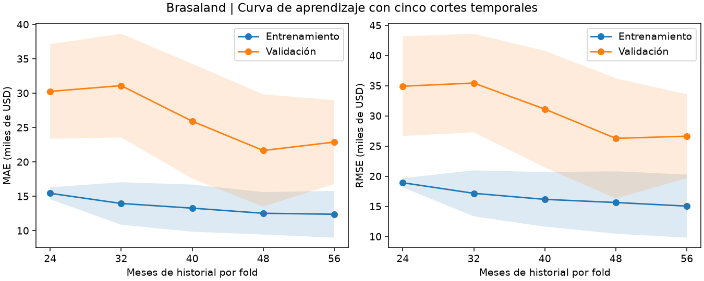

# Evaluación técnica del pronóstico de Brasaland

**Diagnóstico: señales de sobreajuste moderado. Decisión: mantener el modelo en evaluación antes de promoverlo a staging.** El Random Forest supera la referencia estacional en cuatro de cinco cortes, pero conserva una brecha entre error de ajuste y error fuera de muestra. La magnitud exacta atribuible al sobreajuste queda abierta porque el pronóstico recursivo también puede acumular errores.

## Protocolo y control de fuga

Se reutilizó el Random Forest de 200 árboles, profundidad máxima 4, mínimo de 3 muestras por hoja y semilla 42. El objetivo final es `revenue_usd`, ventas mensuales consolidadas de los 14 locales. El bosque aprende la variación respecto al mismo mes del año anterior y el pronóstico se reconstruye en USD. Se usaron filas con `market = consolidated` y solo se evaluaron los meses de enero de 2016 a diciembre de 2023. Los 24 meses de 2024–2025 quedaron fuera de la validación, la curva y la selección de la acción correctiva.

`TimeSeriesSplit` creó cinco ventanas de entrenamiento expansivas de 56 a 88 meses, cada una seguida de ocho meses consecutivos de validación. Los bloques de validación están ordenados y no se solapan. El histórico se amplía entre cortes, tal como ocurriría al avanzar en el calendario. El test unitario verifica estos límites y rechaza un histórico desordenado.

Las variables se calculan dentro de cada ventana. Los rezagos de uno y doce meses y la media de los tres meses anteriores se construyen con el prefijo anterior a cada objetivo. Durante la validación, el modelo recibe del bloque futuro únicamente sus fechas. Los rezagos posteriores al corte se alimentan con pronósticos previos. Las ventas reales del bloque se usan al calcular las métricas. Se requieren 12 meses iniciales para construir los primeros ejemplos.

## Estabilidad por corte

Cifras en USD por mes. La última fila usa la desviación estándar muestral de los cinco cortes.

| Validación | Meses de entrenamiento | MAE entren. | RMSE entren. | MAE valid. | RMSE valid. | MAE estacional |
| --- | ---: | ---: | ---: | ---: | ---: | ---: |
| Sep. 2020–abr. 2021 | 56 | 13.419 | 17.039 | 14.662 | 16.695 | 36.226 |
| May.–dic. 2021 | 64 | 9.142 | 10.345 | 21.035 | 27.589 | 43.202 |
| Ene.–ago. 2022 | 72 | 9.259 | 10.506 | 31.154 | 36.086 | 26.235 |
| Sep. 2022–abr. 2023 | 80 | 16.356 | 21.657 | 20.472 | 23.194 | 40.879 |
| May.–dic. 2023 | 88 | 14.517 | 17.239 | 23.639 | 27.715 | 61.644 |
| **Media ± DE** | | **12.539 ± 3.223** | **15.357 ± 4.866** | **22.192 ± 5.988** | **26.256 ± 7.094** | **41.637 ± 12.940** |

El MAE de validación varió de 14.662 a 31.154 USD; su desviación representa alrededor del 27 % de la media. El bosque redujo un 47 % el MAE medio frente a repetir el mismo mes del último año conocido, pero perdió contra esa referencia entre enero y agosto de 2022. Los bloques tienen ocho meses y miden estabilidad a ese horizonte. Su dispersión describe estos cortes históricos.

La métrica principal es **MAE**: permite explicar a Mariana y Felipe cuánto se desvía en dólares un presupuesto mensual típico. El **RMSE** penaliza más los errores grandes que pueden afectar compras de insumos, especialmente alrededor de la caída de enero y el pico de diciembre que describe el briefing. El RMSE de validación de 26.256 USD justifica revisar esos meses explícitamente además de vigilar el MAE.

## Curva de aprendizaje y diagnóstico



Para comparar tamaños sobre los mismos meses, se mantuvo fijo cada bloque de validación y se ajustaron modelos usando los 24, 32, 40, 48 y 56 meses inmediatamente anteriores a su corte. El error de entrenamiento se calculó sobre los últimos ocho objetivos ajustados de cada ventana, con sus rezagos históricos observados. Los errores de validación corresponden a pronósticos recursivos emitidos al inicio de cada bloque. La zona sombreada representa ± una desviación estándar entre cortes.

Al pasar de 24 a 48 meses, el MAE de validación bajó de **30.271 a 21.673 USD**. Con 56 meses subió a **22.898 USD**, frente a **12.397 USD** en entrenamiento. El RMSE a 56 meses mantuvo una brecha similar (**26.639 frente a 15.055 USD**). La validación mejora con historial hasta 48 meses y después se estabiliza en esta muestra, mientras el error de ajuste sigue siendo sensiblemente menor. Esto respalda el diagnóstico de sobreajuste moderado. La diferencia de protocolo entre ajuste y pronóstico puede contribuir a la brecha.

## Acción correctiva antes de staging

Probar un bosque con `max_depth=3` y `min_samples_leaf=6`, conservando los 200 árboles, la semilla y las variables causales. El cambio limita las ramas y exige el doble de ejemplos por hoja, una intervención dirigida a reducir la varianza con pocos meses disponibles. Comparar esa variante con el modelo actual en los mismos cinco cortes, revisando el MAE medio, su dispersión y el RMSE de los bloques que contienen enero y diciembre. Adoptarla si baja el MAE medio y su dispersión sin aumentar el RMSE en esos bloques. Una vez fijada la variante, verificarla en el horizonte operativo y acordar con Finanzas el error tolerable antes de aprobar staging.

## Reproducción

```bash
uv run python -m scripts.evaluate_sales_learning_curve
uv run python -m pytest -q tests/pipelines/test_sales_temporal_cv.py
```

[Resultados por fold](sales_cv_folds.csv) · [Puntos de la curva](sales_learning_curve.csv) · [Briefing de Brasaland](https://github.com/4GeeksAcademy/ai-engineering-syllabus/blob/main/content/contexts/sales-forecasting/brasaland/brasaland-BRIEFING.es.md)
