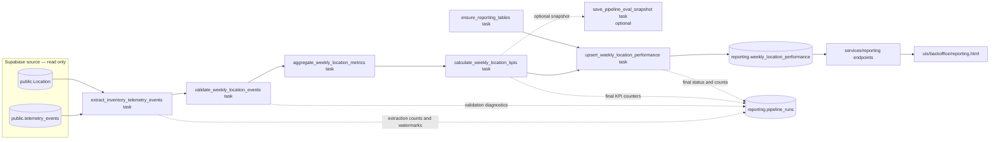

# Business Performance Data Pipeline — Design

- **Status:** Part 3 implementation is on `feat/business-performance-pipeline`: three transformation tasks are coordinated by the transform subflow, unit tests are in `tests/pipelines/test_pipeline.py`, the CLI entrypoint is retained, and a protected KPI dashboard is available from the ERP origin. User-reported local tests and CLI run passed. End-to-end dashboard validation and valid source location mapping remain outstanding.
- **Company:** Brasaland
- **Primary audience:** Mariana Restrepo (CEO) and Felipe Guerrero (Operations Director)
- **Business cadence:** Weekly, every Monday morning
- **Proposed schedule:** Monday at 07:00 in `America/Bogota` (headquarters time; confirm before deployment)
- **Destination:** `reporting.weekly_location_performance`

---

## 1. Current State and Business Gap

### What exists today

Brasaland captures inventory telemetry from its inventory workflows and stores the events in Supabase, in `public.telemetry_events`. The event envelope includes a unique `event_id`, `event_timestamp`, `event_type`, `schema_version`, request/session metadata, and a JSONB `properties` payload.

The current technical reporting path is already implemented:

- `services/telemetry/analysis.py` reads `public.telemetry_events`.
- `GET /telemetry/report` exposes engineering metrics such as event counts by day and type, error events by type, API latency by route, and event volume shares.
- The capture schema includes Brasaland inventory events such as `inbound_order_created`, `outbound_order_created`, `stock_waste_registered`, `stock_threshold_triggered`, and `ingredient_price_variance_detected`.

The inventory domain also has a `Location` entity (table name `"Location"`) with `id`, `name`, `city`, `country`, and `currency`. Inventory products are represented by `inventory_items`; stock movements are represented by `inventory_movements`. The development seed currently contains four locations, so production must use the complete active location roster rather than a hard-coded seed list.

### What the technical report does not answer

The technical report is designed for engineers. It can show whether the application is producing events, where errors occur, and how long API requests take. It does not calculate the business numbers Mariana and Felipe need:

- how much each location spent on purchases during a week;
- how much money each location lost through waste;
- what share of purchase cost was lost to waste;
- how often a location crossed its minimum-stock threshold; or
- how often an ingredient triggered an abnormal price-increase alert.

At the design baseline, there was no weekly, per-location business aggregate in a dedicated reporting table or reporting API. Part 2 now implements that business reporting path; the latest local validation outcome is recorded in Section 13.

**Separation requirement:** this design leaves `services/telemetry/analysis.py` and `GET /telemetry/report` unchanged. `public.telemetry_events` remains a read-only source for this pipeline and is never its output destination.

---

## 2. Pipeline Purpose

Produce the **Weekly Location Cost & Waste Report** for Mariana Restrepo and Felipe Guerrero every Monday by computing **Purchase Cost per Location, Waste Cost per Location, Waste Ratio, Stockout Frequency, and Price Alert Frequency** for each location and ISO week in `reporting.weekly_location_performance`.

This is the only business deliverable in v1. Technical observability metrics such as API latency and application error rate are not part of this report.

---

## 3. KPIs and Business Definitions

The aggregation grain is one row per `location_id` and ISO week. `week_start` is the Monday of the week, calculated using UTC timestamps. The source interval is half-open: `[week_start 00:00 UTC, next_week_start 00:00 UTC)`.

| KPI / destination field | Definition | Source event and calculation | Business decision |
|---|---|---|---|
| **Purchase Cost per Location** — `total_purchase_cost` | Total amount spent on inbound ingredient purchases during the week. | Sum `properties.total_cost` for `inbound_order_created`, grouped by `location_id` and week. | Compare purchasing spend by location and support Lucía's supplier negotiations. |
| **Waste Cost per Location** — `total_waste_cost` | Monetary value of product lost through expiry, kitchen error, or suspected theft. | Sum `properties.total_cost` for `stock_waste_registered`, grouped by location and week. | Help Felipe prioritise waste audits and reduce margin loss. |
| **Waste Ratio** — `waste_ratio` | Waste cost as a proportion of purchase cost. | `total_waste_cost / total_purchase_cost`; return `0` when purchase cost is zero, provided the source window passed data-quality checks. | Compare waste efficiency across locations without confusing high spend with poor performance. |
| **Stockout Frequency** — `stockout_events_count` | Number of times an ingredient crossed from above its configured minimum to at or below that minimum. | Count `stock_threshold_triggered` events for the location and week. | Identify locations at risk of running out of key ingredients during service. |
| **Price Alert Frequency** — `price_alert_events_count` | Number of abnormal ingredient price-increase alerts. | Count `ingredient_price_variance_detected` events for the location and week. | Help Lucía investigate suppliers and renegotiate before price increases compound. |

### Currency rules

- Keep each location's monetary values in its local currency: `COP` for Colombia and `USD` for Florida.
- Populate `country` with the event/domain value `CO` or `US`, and `currency` with `COP` or `USD`.
- Never sum COP and USD into one monetary total. The dashboard may display the countries side by side.
- Currency conversion is explicitly out of scope for v1; it requires a separately governed FX-rate source and accounting policy.

### Event semantics

- `stock_threshold_triggered` is emitted when stock crosses the reorder threshold, not for every subsequent moment that stock remains low. The KPI therefore counts threshold-crossing events.
- `ingredient_price_variance_detected` is emitted by the current inventory workflow for a positive increase at or above its configured threshold (currently 10% against the previous price for the same product and supplier). The KPI counts those emitted alerts; it does not independently infer price changes.
- `outbound_order_created` is retained as contextual operational data for reconciliation or anomaly investigation, but it is not a KPI input in v1.

---

## 4. Source Data and Extraction Contract

### Source tables

1. **`public.telemetry_events` — primary source, read-only.** Query the event envelope and JSONB `properties`. Deduplicate by `event_id`.
2. **`public."Location"` — reference/dimension source.** Validate `location_id`, country, and currency and obtain the active location roster. It is not a source of monetary KPI values.

The pipeline does not write to either source table. It does not need to read `services/telemetry/analysis.py` or call `GET /telemetry/report`.

### Event types in scope

| Event type | Role in this pipeline | Required properties used |
|---|---|---|
| `inbound_order_created` | Purchase Cost per Location | `location_id`, `country`, `product_id`, `quantity`, `unit`, `currency`, `unit_cost`, `total_cost`, `supplier_id`, `order_id` |
| `outbound_order_created` | Context only; useful for checking movement volume, but not counted as a KPI | `location_id`, `product_id`, `quantity`, `unit`, `currency`, `order_id`, `reason` |
| `stock_waste_registered` | Waste Cost per Location and Waste Ratio | `location_id`, `country`, `product_id`, `quantity`, `unit`, `currency`, `reason`, plus the additive cost fields described below |
| `stock_threshold_triggered` | Stockout Frequency | `location_id`, `country`, `product_id`, `quantity`, `unit`, `currency`, `threshold_quantity` |
| `ingredient_price_variance_detected` | Price Alert Frequency | `location_id`, `country`, `product_id`, `currency`, `supplier_id`, `current_unit_cost`, `reference_unit_cost`, `variance_percent`, `threshold_percent` |

The source payload is JSONB, so extraction must parse and type-check numeric values rather than assume that every property is already a numeric database column. All event timestamps are normalised to UTC before week assignment.

### Cost-field producer contract and current behavior

The inventory producer and telemetry property allowlist include `unit_cost` and `total_cost` for `inbound_order_created` and `stock_waste_registered`; no new event type or envelope was introduced.

- For `inbound_order_created`, the producer calculates `total_cost` from the movement quantity and captured unit cost. The source can still provide a missing unit cost, so the pipeline validates both values and rejects an event if the cost snapshot is missing or invalid.
- For `stock_waste_registered`, the producer snapshots the latest available inbound unit cost for the same inventory item and calculates the waste total. If no prior valid cost exists, it emits null cost fields; the pipeline rejects the event instead of treating cost as zero.
- Historical events without cost snapshots remain readable but cannot contribute a trustworthy monetary KPI.
- Last-known inbound unit cost is the valuation basis for waste and still requires Finance approval before the report is treated as production financial reporting.

Invalid or missing cost data blocks publication for the affected location/week, increments rejection diagnostics, and makes the run `partial`. Other unaffected location/weeks may still load.

### Refresh cadence and window

- **Scheduled run:** every Monday morning, proposed at 07:00 `America/Bogota` to align with Brasaland headquarters and the company's Monday report expectation.
- **Primary reporting period:** the most recently completed ISO week, using UTC week boundaries.
- **Late-arriving events:** each scheduled execution re-aggregates the most recently completed week plus the previous three completed weeks (a 28-day correction window). This lets late events update already-published weekly rows.
- **Older corrections:** a manual backfill can target an explicit `week_start`. Runs must record the exact UTC interval processed.
- **Extraction format:** read-only SQL result rows for the bounded UTC window containing `event_id`, `event_timestamp`, `event_type`, and `properties`; only the in-scope event types are selected. The current implementation fetches the bounded result set in one query rather than paging it.

---

## 5. Data Flow



### Stage responsibilities

**1. Extraction — `extract_inventory_telemetry_events`**

- Read events from `public.telemetry_events` for the explicit UTC period and event-type allowlist.
- Read the `Location` reference roster and validate each event's `location_id`, `country`, and `currency` against it.
- Select only fields required for the five KPIs and reconciliation. Do not extract user names, customer data, credentials, request bodies, or unrelated telemetry.

**2. Transformation and validation — `transform_weekly_location_kpis_subflow`**

- `validate_weekly_location_events` deduplicates by `event_id`, validates event properties, IDs, timestamps, location/country/currency, and required cost snapshots, then returns normalized accepted events and quality diagnostics.
- `aggregate_weekly_location_metrics` aggregates the validated events at exactly `location_id + week_start`, producing `total_purchase_cost`, `total_waste_cost`, `stockout_events_count`, and `price_alert_events_count`.
- `calculate_weekly_location_kpis` computes `waste_ratio`, removes blocked location/week grains, sorts the output, and returns the stable result contract used by the load stage.
- The transform subflow calls the three Prefect tasks in order with explicit outputs. The cost ratio is never calculated before the purchase and waste totals are available.
- Monetary totals retain the location's local currency; COP and USD are never combined.

**3. Load and audit**

- `ensure_reporting_tables` creates/checks the reporting objects. Write KPI results only to `reporting.weekly_location_performance`.
- `upsert_weekly_location_performance` uses a transaction and the `(location_id, week_start)` unique key.
- `save_pipeline_run` records run metadata, watermarks, counts, quality results, and errors in `reporting.pipeline_runs`.
- Mark a run `completed` only after destination upserts and final audit update succeed. Use `partial` when data-quality issues prevent a trustworthy complete result; use `failed` for execution failures.
- `save_pipeline_eval_snapshot` writes an optional local quality artifact under `data/eval/`. Its failure is logged and does not prevent the KPI load.

## 6. Destination and Update Strategy

### KPI destination table

Create the destination under the dedicated `reporting` schema with the exact name and grain specified in the Brasaland data-pipelines BRIEFING:

```sql
CREATE SCHEMA IF NOT EXISTS reporting;

CREATE TABLE reporting.weekly_location_performance (
    id UUID PRIMARY KEY DEFAULT gen_random_uuid(),
    location_id TEXT NOT NULL,
    country TEXT NOT NULL,
    week_start DATE NOT NULL,
    total_purchase_cost NUMERIC NOT NULL DEFAULT 0,
    total_waste_cost NUMERIC NOT NULL DEFAULT 0,
    waste_ratio NUMERIC NOT NULL DEFAULT 0,
    stockout_events_count INTEGER NOT NULL DEFAULT 0,
    price_alert_events_count INTEGER NOT NULL DEFAULT 0,
    currency TEXT NOT NULL,
    computed_at TIMESTAMPTZ NOT NULL DEFAULT now(),
    UNIQUE (location_id, week_start)
);
```

The unique constraint is the business-grain key. Do not replace it with `event_id`: the destination stores weekly aggregates, not raw events.

### Updating existing weekly records

Telemetry is append-only, but weekly aggregates can change when an event arrives late. The scheduled 28-day correction window re-computes complete weekly groups from source events, then runs:

```sql
INSERT INTO reporting.weekly_location_performance (
    location_id, country, week_start,
    total_purchase_cost, total_waste_cost, waste_ratio,
    stockout_events_count, price_alert_events_count, currency, computed_at
)
VALUES (...)
ON CONFLICT (location_id, week_start)
DO UPDATE SET
    country = EXCLUDED.country,
    total_purchase_cost = EXCLUDED.total_purchase_cost,
    total_waste_cost = EXCLUDED.total_waste_cost,
    waste_ratio = EXCLUDED.waste_ratio,
    stockout_events_count = EXCLUDED.stockout_events_count,
    price_alert_events_count = EXCLUDED.price_alert_events_count,
    currency = EXCLUDED.currency,
    computed_at = now();
```

A re-run replaces the aggregate for that location/week with the recomputed value; it does not add the same event contribution a second time. A historical correction outside the 28-day window requires an explicit backfill for that `week_start`.

### Duplicate handling

- **Source layer:** `event_id` is the event-envelope deduplication key. The existing telemetry storage uses `ON CONFLICT (event_id) DO NOTHING`.
- **Pipeline batch:** discard duplicate `event_id` values before aggregation and count them in run diagnostics.
- **Business output:** `(location_id, week_start)` is the unique aggregate key; the load always uses upsert.

---

## 7. Idempotency, Recoverability, and Concurrency

### Idempotency guarantee

For a fixed source snapshot and the same `week_start`, the transformation is deterministic and produces the same values. The destination unique key and upsert make repeated loads safe.

**Second-run scenario after a load failure:**

1. A run extracts and transforms one weekly window. The load writes some location rows, then the database connection drops.
2. The run log remains `failed` (or `partial` if the failure happened after a committed subset), with its `run_id`, period, counts, and `last_completed_stage = transform`.
3. The retry uses the same reporting week. It re-extracts and re-aggregates that full week (the transformed batch is not assumed to survive a worker restart), then upserts every output row again.
4. Rows already committed are updated using the same `(location_id, week_start)` key; rows not yet committed are inserted. No duplicate KPI rows are created and previously loaded totals are not added to again.
5. The run is marked `completed` only after all location rows pass validation and the finalisation transaction commits.

Do not resume by blindly skipping the first 60% of location keys: the checkpoint may be ahead of or behind the actual database commit after a network failure. Replaying the complete weekly aggregate through an idempotent upsert is safer for this small 14-location report.

### Checkpoint and database outage

Persist the period and phase checkpoint in `reporting.pipeline_runs`:

- `week_start`, `watermark_from`, and `watermark_to` identify the exact source window;
- `last_completed_stage` records `extract`, `transform`, or `load`;
- row counters show how far the run progressed;
- `status` and `error_summary` explain why it stopped.

If Supabase is unavailable during extraction, retry the extraction with bounded exponential backoff. If it is unavailable during load, keep the run non-completed and replay the full window on recovery. Since the source is append-only and the destination is upserted by business grain, replay is safe. A source snapshot is not retained in memory as a durable checkpoint.

### Concurrent scheduled and manual runs

A scheduled Monday flow and a manual API trigger can target the same `week_start`. Use both:

- a Prefect concurrency limit of one active run for this pipeline; and
- a PostgreSQL advisory lock keyed by pipeline name and `week_start` as a database-level guard.

A run must acquire the lock before loading. If another run owns the same window, the new request is queued or rejected as already running; it must not perform a parallel write. Always release the lock in a `finally` path and record the outcome under a distinct `run_id`.

---

## 8. Observability and Execution Log

Create a separate audit table, `reporting.pipeline_runs`. It is execution metadata, not a second KPI destination.

| Field | Type | Why it is required |
|---|---|---|
| `run_id` | UUID, primary key | Uniquely identifies one scheduled, manual, or backfill execution and correlates logs. |
| `pipeline_name` | TEXT | Identifies the pipeline when more reporting jobs are added. |
| `week_start` | DATE | Identifies the business week being computed. |
| `started_at` | TIMESTAMPTZ | Establishes when processing began and supports SLA/audit timelines. |
| `finished_at` | TIMESTAMPTZ, nullable | Measures duration and identifies runs that did not finish. |
| `status` | TEXT/ENUM (`running`, `completed`, `partial`, `failed`) | Lets the API and operators distinguish success from incomplete data or execution failure. |
| `last_completed_stage` | TEXT, nullable | Provides a recoverability checkpoint for extraction, transformation, and load. |
| `watermark_from` / `watermark_to` | TIMESTAMPTZ | Records the exact UTC event-time interval included in the run. |
| `rows_extracted` | INTEGER | Detects unexpectedly empty or truncated source windows. |
| `records_processed` | INTEGER | Counts valid in-scope events accepted by transformation for aggregation. |
| `rows_rejected` | INTEGER | Makes malformed payloads and missing cost values visible instead of silently dropping them. |
| `rows_loaded` | INTEGER | Reconciles run output with the number of location/week rows written. |
| `error_summary` | TEXT, nullable | Gives the operator a readable failure reason without requiring raw stack traces. |
| `pipeline_version` | TEXT (Git SHA or semantic version) | Makes a report reproducible against the transformation version that created it. |
| `trigger_source` | TEXT (`schedule`, `manual`, `backfill`) | Explains why the flow ran and supports audit of manual actions. |

### Minimum run-level monitoring

Record event counts by `event_type`, counts of missing/invalid cost payloads, distinct locations observed, the maximum event timestamp per location/type, and dropped-event signals where available. Alert on failed/partial runs, missing cost values, invalid currency combinations, unexpectedly empty windows, and a report that misses the Monday freshness target.

**Silence versus true absence:** zero matching business events does not, by itself, prove that a location had zero activity; it can also mean capture was unavailable. The current mandatory event contract has no per-location heartbeat. In v1, expose run-level source coverage and do not describe an unobserved location as confirmed zero business activity. A per-location heartbeat/coverage event would improve this distinction but is an explicit future telemetry enhancement, not a new event type in this v1 pipeline.

Keep audit records for both successful and failed runs. Do not log employee names, customer data, secrets, or raw event payloads.

---

## 9. Prefect Implementation and Resilience

The implemented pipeline uses Prefect 3 for task execution, retries, caching, flow state, and run observability. ETL orchestration remains under `data/pipelines/`; the reporting API imports pipeline functions, and the pipeline does not import the HTTP service. Pure transformations may be extracted to `data/process/` when reuse justifies it.

### Main flow

- **Flow:** `weekly_location_cost_waste_flow(week_start=None, trigger_source="schedule")`.
- **Scheduled deployment:** every Monday at 07:00 `America/Bogota`; inactive until a production Prefect worker/work pool and business approval are in place.
- **Manual/backfill:** accepts an optional Monday `week_start` and records the `trigger_source`.

### Implemented subflows and tasks

| Subflow | Task sequence | Responsibility |
|---|---|---|
| `extract_inventory_telemetry_subflow` | `extract_inventory_telemetry_events` | Read the bounded telemetry window and location roster. |
| `transform_weekly_location_kpis_subflow` | `validate_weekly_location_events` → `aggregate_weekly_location_metrics` → `calculate_weekly_location_kpis` | Validate and normalize events, aggregate the four additive metrics, and calculate the final ratio/output contract. |
| `load_weekly_location_performance_subflow` | `upsert_weekly_location_performance` | Idempotently load location/week KPI rows. |

| Task | Stage | Resilience / responsibility |
|---|---|---|
| `extract_inventory_telemetry_events` | Extract | Read the event window and location roster; 3 retries with a 5-second delay for transient database failures. |
| `validate_weekly_location_events` | Transform | Deduplicate and validate event records; returns accepted normalized records and quality diagnostics. |
| `aggregate_weekly_location_metrics` | Transform | Aggregate purchase/waste costs and stockout/price-alert counts by location/week. |
| `calculate_weekly_location_kpis` | Transform | Calculate `waste_ratio` and produce the final KPI contract; uses `task_input_hash`, a one-hour cache expiration, and persisted task results. |
| `ensure_reporting_tables` | Load setup | Create/check reporting schema and tables; 3 retries with a 5-second delay. |
| `upsert_weekly_location_performance` | Load | Transactionally upsert by `(location_id, week_start)`; 3 retries with a 5-second delay. |
| `save_pipeline_run` | Audit | Insert/update run metadata; 3 retries with a 5-second delay. |
| `save_pipeline_eval_snapshot` | Optional evaluation | Write a local JSON quality snapshot under `data/eval/`; invoked with `return_state=True`, so failure is logged and the reporting load continues. |

### States, failure handling, and retry policy

- `completed`: required stages and final audit update succeeded with no rejected source records.
- `partial`: the flow completed but source-quality problems caused event rejection or blocked a location/week from publication.
- `failed`: a critical task or unexpected execution error stopped the flow.
- Extraction, transformation, and load subflow states are checked explicitly with `return_state=True`; a failure in these critical stages fails the flow.
- The evaluation snapshot is non-critical. Its failed state is logged through the Prefect flow logger and does not fail the main load.
- The flow-level exception handler includes lock acquisition, table setup, and the initial audit write. It logs failures through Prefect and attempts to persist a failed audit row. If the reporting database is unavailable, the Prefect run log is the fallback.
- Database tasks use 3 retries with a fixed 5-second delay. A retry replays the full reporting window through the idempotent upsert.

The transformation cache key is based on task inputs, including the transform revision. A result can be reused for up to one hour when the same inputs are supplied; `persist_result=True` lets Prefect retrieve the cached result.

### Production configuration

Keep production credentials in Prefect blocks/secrets or deployment environment variables, never in source control. The API must not receive database credentials. The Monday schedule remains inactive until the production worker/work pool is configured and the business assumptions are approved.

## 10. Application Integration — Reporting Service

The `services/reporting/` module is implemented separately from `services/telemetry/` and `GET /telemetry/report`. Its router is included in the API application. The endpoint layer validates requests and imports functions from `data/pipelines/`; it contains no extraction, transformation, or load logic. All three routes use the existing authenticated staff dependency.

| Endpoint | Purpose | Function imported from `data/pipelines/` |
|---|---|---|
| `GET /reporting/pipeline-runs/latest` | Return the most recent run's status, timestamps, week, counts, and error summary. | `get_latest_pipeline_run()` |
| `POST /reporting/pipeline-runs` | Trigger a manual run or backfill; accept an optional `week_start` and return a run identifier/status. | `trigger_weekly_location_cost_waste_flow(week_start)` |
| `GET /reporting/weekly-location-performance` | Return location KPI rows for a requested `week_start`; default to the most recent week present in the reporting table. | `get_weekly_location_performance(week_start)` |

The KPI response follows the BRIEFING contract:

```json
{
  "week_start": "YYYY-MM-DD",
  "locations": [
    {
      "location_id": "CO-MDE-01",
      "country": "CO",
      "total_purchase_cost": 0,
      "total_waste_cost": 0,
      "waste_ratio": 0,
      "stockout_events_count": 0,
      "price_alert_events_count": 0,
      "currency": "COP"
    }
  ]
}
```

The values above illustrate the response shape only; they are not actual Brasaland business figures. Each location object contains exactly the KPI fields shown above; `week_start` is returned at the response top level. The endpoint must never combine currency totals across locations/countries.

---

## 11. Scope, Assumptions, and Non-Goals

### In scope

- One weekly business deliverable: the Weekly Location Cost & Waste Report.
- The five BRIEFING KPIs at location/week grain.
- Read-only extraction from telemetry and location reference data.
- The additive cost payload fields required to calculate purchase and waste monetary values.
- A separate reporting destination, execution audit, Prefect design, and three reporting endpoints.

### Out of scope for this design

- Replacing, refactoring, or extending the technical calculations in `services/telemetry/analysis.py` or `GET /telemetry/report`.
- Writing pipeline output into `telemetry_events`.
- FX conversion between COP and USD.
- Sales, revenue, customer, HR, or marketing KPIs not requested by the data-pipelines BRIEFING.
- Replacing or modifying the technical telemetry dashboard or `GET /telemetry/report`.

### Production gates to confirm

1. Mariana/Felipe accept the Monday 07:00 `America/Bogota` schedule and a production Prefect worker/work pool is provisioned.
2. Lucía/Finance approve last-known inbound unit cost as the v1 valuation basis for waste.
3. The production `Location` reference contains all active locations and the correct country/currency mapping. The latest local run rejected an event with `location_id = 1` because no matching `public."Location".id` exists; confirm the canonical location mapping before treating that week as complete.
4. Historical waste events without a cost snapshot cannot be reconstructed reliably from telemetry alone. Such events remain rejected until the business owner accepts the gap or a governed correction is supplied.

---

## 12. Source References

- [Brasaland company briefing](https://github.com/4GeeksAcademy/ai-engineering-syllabus/blob/main/content/contexts/00-general-contexts/brasaland-BRIEFING.es.md)
- [Brasaland data-pipelines BRIEFING](https://github.com/4GeeksAcademy/ai-engineering-syllabus/blob/main/content/contexts/06-telemetry-data-pipelines/data-pipelines/brasaland-BRIEFING.md)
- [Brasaland telemetry BRIEFING](https://github.com/4GeeksAcademy/ai-engineering-syllabus/blob/main/content/contexts/06-telemetry-data-pipelines/telemetry/brasaland-BRIEFING.md)
- [Current telemetry analysis](../../services/telemetry/analysis.py)
- [Current telemetry event schema and allowlist](../../services/api/app/telemetry.py)
- [Current inventory event producers and domain models](../../services/api/app/inventory/)

## Running the pipeline

From the repository root, run:

```bash
PYTHONPATH=services/api uv run --python 3.12 python data/pipelines/pipeline.py
```

The command processes the most recently completed week and recalculates the
previous three weeks to include late-arriving events. It requires
`SOURCE_DATABASE_URL` and `REPORTING_DATABASE_URL` to be configured in
`.env.local`. The source connection reads telemetry and locations; the reporting
connection creates/updates only objects in the `reporting` schema. Start with a
non-production Supabase project for verification.

To process a specific week, provide that week's Monday:

```bash
PYTHONPATH=services/api uv run --python 3.12 python -c \
'from data.pipelines.pipeline import weekly_location_cost_waste_flow; weekly_location_cost_waste_flow(week_start="2026-11-02", trigger_source="backfill")'
```

The planned schedule is weekly on Mondays at 07:00 in `America/Bogota`.
Automatic scheduling remains inactive until a Prefect worker is configured.

## 13. Implementation and Latest Local Verification

The user confirmed that the Part 3 unit-test command and the documented CLI command completed locally. The dashboard is implemented at `uis/backoffice/reporting.html` and copied into the ERP's `public/backoffice/` directory so it shares the ERP origin and Supabase SSR session. The ERP Next.js route `/api/reporting/weekly-location-performance` validates the staff cookie session, restricts access to dashboard-authorized roles, and proxies the request to the authenticated FastAPI reporting endpoint. Local browser/API integration still needs a final verification after the proxy change.

The latest recorded Supabase pipeline result from Part 2 was `partial`:

| Run result | Value |
|---|---:|
| Events extracted | 5 |
| Events accepted for KPI aggregation | 0 |
| Events rejected | 1 |
| KPI rows loaded | 0 |
| Run status | `partial` |

The rejected inbound event supplied `location_id = 1`, but no row with `id = '1'` exists in `public."Location"`. The pipeline correctly rejects the unknown location rather than guessing a mapping. Do not change the event or invent a location mapping until the canonical location ID is confirmed. The source tables remain read-only. Rerun the pipeline after confirming/fixing the test event or canonical mapping so the destination contains real KPI rows and the dashboard can display them.

### Part 3 commands

From the repository root, run the transformation unit tests:

```bash
python -m pytest tests/pipelines/test_pipeline.py
```

Run the complete pipeline through its retained CLI entrypoint:

```bash
PYTHONPATH=services/api uv run --python 3.12 python data/pipelines/pipeline.py
```

For local ERP dashboard access, run the ERP Next.js app on port 3000 and the FastAPI service on port 8000, sign in at `/login`, then open `/backoffice/reporting.html`. The Next.js proxy reads the CRM's Supabase SSR cookies and forwards the access token to FastAPI. Set `REPORTING_API_URL` in production to the public HTTPS origin of the FastAPI service; locally it falls back to `NEXT_PUBLIC_INVENTORY_API_URL` or `http://127.0.0.1:8000`.
